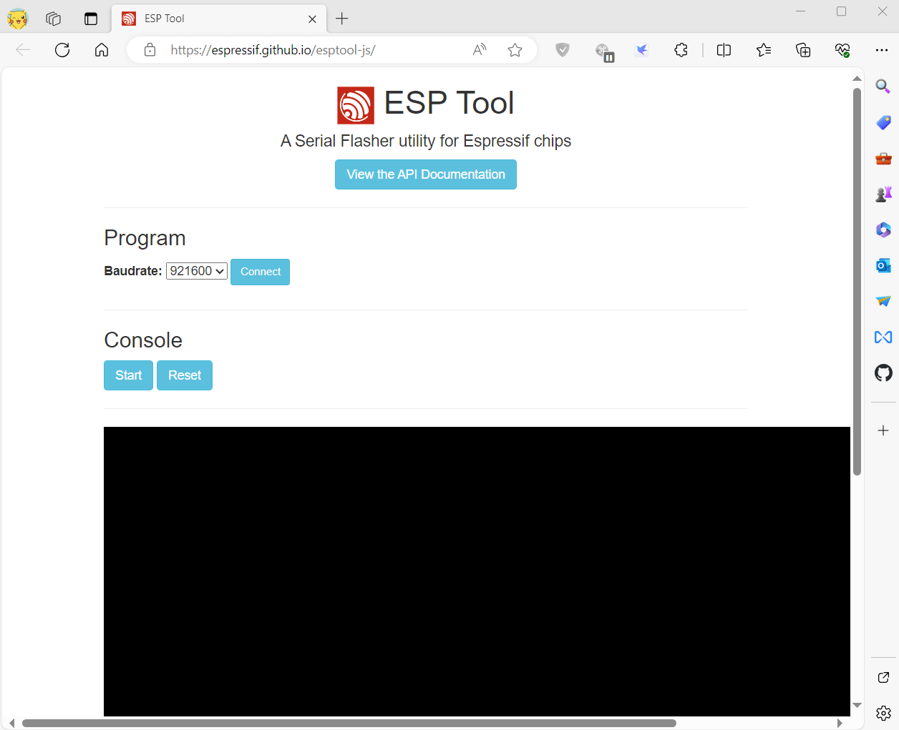

## News

The images in this directory are merged ESP32-S3 binaries. They include the
bootloader, partition table, boot application and application, and must be
flashed at address `0x0`.

- **Factory** is the standard production test for every supported AMOLED board.
- **FactoryV2** is the extended test application. Its Shield-only functions are
  available only on T-Display-S3 AMOLED Plus with the matching Shield.

## 1️⃣Support Product

| Product (PinMap)              | Factory | FactoryV2 |
| ----------------------------- | ------- | --------- |
| [T-Display-AMOLED-Lite][1]    | [Download](./esp32s3-t-display-amoled-factory-20261111_0x0.bin) | [Download](./esp32s3-t-display-amoled-factory-v2-20261111_0x0.bin) |
| [T-Display-S3 AMOLED][2]      | [Download](./esp32s3-t-display-amoled-factory-20261111_0x0.bin) | [Download](./esp32s3-t-display-amoled-factory-v2-20261111_0x0.bin) |
| [T4-S3][3]                    | [Download](./esp32s3-t-display-amoled-factory-20261111_0x0.bin) | [Download](./esp32s3-t-display-amoled-factory-v2-20261111_0x0.bin) |
| [T-Display-S3 AMOLED Plus][4] | [Download](./esp32s3-t-display-amoled-factory-20261111_0x0.bin) | [Download](./esp32s3-t-display-amoled-factory-v2-20261111_0x0.bin) |

[1]: https://www.lilygo.cc/products/t-display-amoled-lite
[2]: https://www.lilygo.cc/products/t-display-s3-amoled
[3]: https://www.lilygo.cc/products/t4-s3
[4]: https://www.lilygo.cc/products/t-display-s3-amoled-plus


## 2️⃣How to Flash ?


> \[!IMPORTANT]
>
> 🤖 USB ports keep popping in and out?
> Follow the steps below to put your device into download mode
>
>  1. Connect the board via the USB cable
>  2. Press and hold the **BOOT** button , While still pressing the **BOOT** button
>  3. Release the **RST** button
>  4. Release the **BOOT** button
>  5. The USB port should be fixed and will not flash again. You can click Upload.
>  6. Press the **RST** button to exit download mode


### Use ESP Download Tool

- Download [Flash_download_tool](https://www.espressif.com.cn/sites/default/files/tools/flash_download_tool_3.9.5_0.zip)


* Note that after writing is completed, you need to press RST to reset.

### Use Web Flasher

- [ESP Web Flasher Online](https://espressif.github.io/esptool-js/)



* Note that after writing is completed, you need to press RST to reset.

### Use command line


If system asks about install Developer Tools, do it.

```
python3 -m pip install --upgrade pip
python3 -m pip install esptool
```

In order to launch esptool.py, exec directly with this:

```
python3 -m esptool
```

For ESP32-S3 use the following command to write

```
esptool --chip esp32s3 --baud 921600 --before default_reset --after hard_reset write_flash -z --flash_mode dio --flash_freq 80m 0x0 esp32s3-t-display-amoled-factory-20261111_0x0.bin

```

To flash FactoryV2, replace the file name with
`esp32s3-t-display-amoled-factory-v2-20261111_0x0.bin`.

# 3️⃣FAQ

- Can't upload any sketch，Please enter the upload mode manually.
   1. Connect the board via the USB cable
   2. Press and hold the **BOOT** button , While still pressing the **BOOT** button (If there is no **BOOT** button, you need to use wires to connect **GND** and **IO0** together.)
   3. Press **RST** button
   4. Release the **RST** button
   5. Release the **BOOT** button (If there is no **BOOT** button, disconnect IO0 from GND.)
   6. Upload sketch
   7. Press the **RST** button to exit download mode

- How do I prove to LilyGo that the board is damaged?
  1. You need to shoot a video to prove that the board is damaged. Follow the steps below to shoot a video to prove that the board is damaged.
  2. Follow the first step of the FAQ on this page to put the board into download mode
  3. Select a flashing tool, download one of the merged firmware images above and flash it to address `0x0`.
  4. After waiting for the burning to complete, press the RST button, or disconnect the USB and then reinsert it.
  5. Any of the above steps must be included in the video content for clarification
