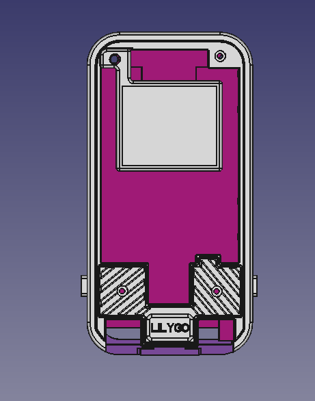
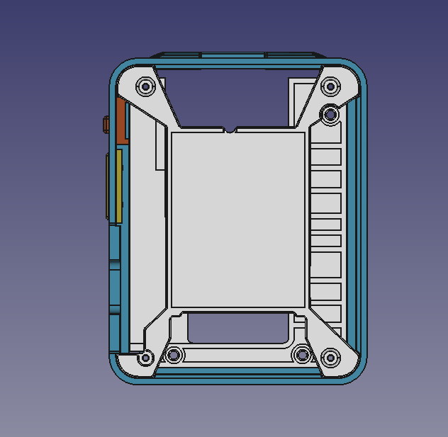

# T-Display-S3-AMOLED

> \[!TIP]
>
> The four screw holes are 1.2 mm in size.
>

# T4-S3-AMOLED

> \[!TIP]
>
> The four screw holes are 1.2 mm in size.
>

# T-Display-AMOLED-Lite

[Shared by brwilkinson/lynx-euc-hud](https://github.com/brwilkinson/lynx-euc-hud)
